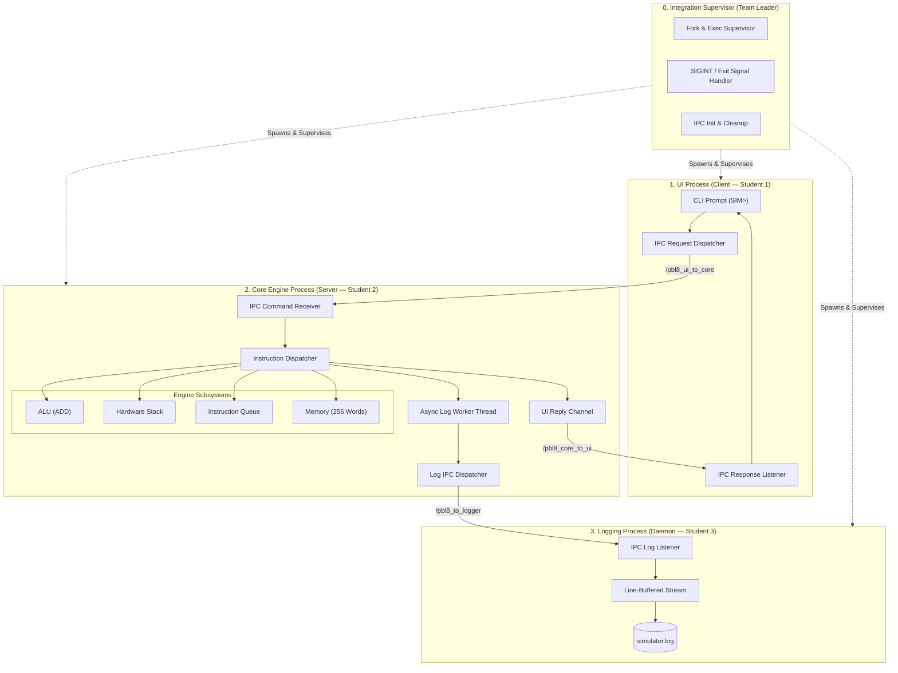
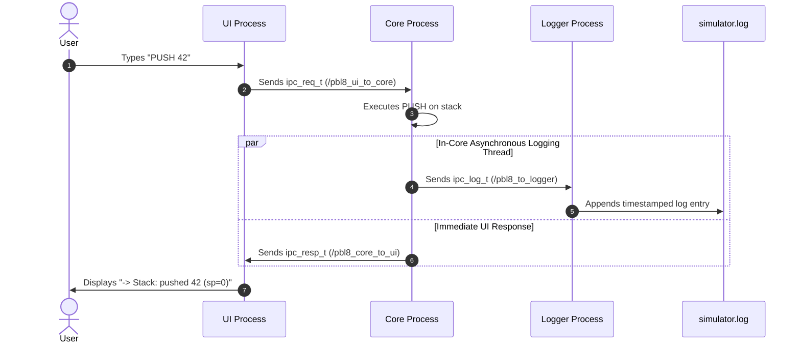

# Project-Based Learning (PBL)

**Information Science and Engineering**  
**School of Engineering, St Aloysius (Deemed to be University), Mangaluru**  
*Subject:* PBL | *Team:* Team 8

[](https://en.wikipedia.org/wiki/C_(programming_language))
[](https://pubs.opengroup.org/)
[](https://ubuntu.com/)
[](#team-8-responsibility-matrix)

---

## Team 8 Responsibility Matrix

| Member | Role | Assigned Component & Primary Files | Individual IPC Research |
| :--- | :--- | :--- | :--- |
| **Waqqas** | **Team Leader** | System Integration, Process Supervisor (`supervisor.c`), Benchmarking Suite | POSIX Shared Memory (`shm_demo.c` + PDF) |
| **Sneha** | **Student 1** | UI Frontend Process (`ui_main.c`), Interactive CLI & Protocol Framing | System V / POSIX Message Queues (`sender.c`, `receiver.c` + PDF) |
| **Siddanth** | **Student 2** | CPU Core Engine (`core_main.c` — Stack, Memory, ALU), Async Log Queue | Anonymous Pipes & Named FIFOs (`pipe_demo.c`, `fifo_*.c` + PDF) |
| **Rafath** | **Student 3** | Dedicated Logging Daemon (`logger_main.c`), Disk Log Collector | Sockets, Signals & Semaphores (`semaphore_demo.c`, `tcp_*.c` + PDF) |

---

## Project Architecture & Scope

This project implements three core systems deliverables for the OS PBL curriculum:

1. **[Week 3: CPU Process Scheduling Simulator](#1-week-3--cpu-process-scheduling-simulator)**: An interactive simulator evaluating **FCFS, SJF (Preemptive & Non-Preemptive), Priority (Preemptive & Non-Preemptive), and Round Robin** with automated ASCII Gantt charts and performance analysis across 3 test datasets.
2. **[Week 4: Multi-Process CPU Simulator with POSIX IPC](#2-week-4--multi-process-simulator-with-posix-ipc)**: A modular system decoupling a single-process CPU simulator into **three independent cooperating processes** (UI, Core, Logger) communicating via POSIX Message Queues with an asynchronous in-core worker thread.
3. **[Week 4: Interactive Deadlock Simulation System (with GUI)](#3-week-4--interactive-deadlock-simulation-system-with-gui)**: An interactive simulation and analysis platform managing multi-process resource allocation, evaluating **SAFE / UNSAFE / DEADLOCKED** states, running **Banker's Algorithm**, detecting deadlocks, executing automated recovery policies, and visualizing **Resource Allocation Graphs (RAG)** via both a 12-item CLI and a modern Graphical User Interface (GUI).

---

## 1. Week 3 — CPU Process Scheduling Simulator

### Objective
> *"Design and implement a process scheduling simulator that can simulate different CPU scheduling algorithms and analyze their performance metrics."*

The simulator accepts process sets defined by **Arrival Time**, **Burst Time**, and **Priority**, schedules them under configurable policies, and computes **Waiting Time (WT)**, **Turnaround Time (TAT)**, **Response Time (RT)**, and **CPU Utilization**.

### Supported Scheduling Algorithms
* **FCFS** (First-Come-First-Served)
* **SJF Non-Preemptive** (Shortest Job First)
* **SRTF Preemptive** (Shortest Remaining Time First)
* **Priority Scheduling Non-Preemptive** (Lower integer = higher priority)
* **Priority Scheduling Preemptive**
* **Round Robin (RR)** with configurable time quantum ($q$)

### Benchmark Test Datasets

<details open>
<summary><b>Click to expand built-in test case tables</b></summary>

| Dataset | Description | Process Attributes (PID, Arrival, Burst, Priority) |
| :--- | :--- | :--- |
| **Test Case 1** *(Default)* | Staggered arrival times with mixed burst | **P1**:(0, 8, 3) \| **P2**:(1, 4, 1) \| **P3**:(2, 9, 4) \| **P4**:(3, 5, 2) |
| **Test Case 2** | Mixed priority competition | **P1**:(0, 5, 2) \| **P2**:(1, 3, 1) \| **P3**:(2, 8, 4) \| **P4**:(3, 6, 3) |
| **Test Case 3** | Simultaneous arrival workload ($t = 0$) | **P1**:(0, 10, 3) \| **P2**:(0, 5, 1) \| **P3**:(0, 2, 4) \| **P4**:(0, 4, 2) |

</details>

---

### Sample Execution Output & Gantt Chart (Test Case 1)

#### SRTF (Preemptive SJF)
```text
====================================================================
 Results for Algorithm: 3. Shortest Remaining Time First (SRTF Preemptive)
====================================================================
 PID | Arrival | Burst | Priority | Start | Compl | Wait | TAT | Resp 
-----+---------+-------+----------+-------+-------+------+-----+------
 1   | 0       | 8     | 3        | 0     | 17    | 9    | 17  | 0    
 2   | 1       | 4     | 1        | 1     | 5     | 0    | 4   | 0    
 3   | 2       | 9     | 4        | 17    | 26    | 15   | 24  | 15   
 4   | 3       | 5     | 2        | 5     | 10    | 2    | 7   | 2    
-----+---------+-------+----------+-------+-------+------+-----+------
 Average Waiting Time    : 6.50 ms
 Average Turnaround Time : 13.00 ms
 Average Response Time   : 4.25 ms
 CPU Utilization         : 100.00 %

Gantt Chart:
+-------+-------+-------+-------+-------+
|  P1   |  P2   |  P4   |  P1   |  P3   |
+-------+-------+-------+-------+-------+
0      1       5       10      17      26      
```

#### Round Robin ($q = 3$)
```text
Gantt Chart:
+-------+-------+-------+-------+-------+-------+-------+-------+-------+-------+
|  P1   |  P2   |  P3   |  P4   |  P1   |  P2   |  P3   |  P4   |  P1   |  P3   |
+-------+-------+-------+-------+-------+-------+-------+-------+-------+-------+
0      3       6       9       12      15      16      19      21      23      26      
```

---

### Comparative Performance Analysis (Test Case 1)

| Algorithm | Avg Waiting Time (ms) | Avg Turnaround Time (ms) | Avg Response Time (ms) | CPU Utilization |
| :--- | :---: | :---: | :---: | :---: |
| **FCFS** | 8.75 | 15.25 | 8.75 | 100.00% |
| **SJF (Non-Preemptive)** | 7.75 | 14.25 | 7.75 | 100.00% |
| **SRTF (Preemptive)** | **6.50** | **13.00** | 4.25 | 100.00% |
| **Priority (Non-Preemptive)** | 7.75 | 14.25 | 7.75 | 100.00% |
| **Priority (Preemptive)** | **6.50** | **13.00** | 4.25 | 100.00% |
| **Round Robin ($q=3$)** | 13.50 | 20.00 | **3.00** | 100.00% |

#### Observations
1. **SRTF (Preemptive SJF)** achieved the lowest Average Waiting Time (**6.50 ms**) and Turnaround Time (**13.00 ms**) by preventing longer jobs from holding the CPU when shorter tasks arrive.
2. **Round Robin** introduced higher waiting and turnaround times due to frequent time slicing, but delivered the fastest Average Response Time (**3.00 ms**), demonstrating why time-sharing operating systems prefer Round Robin for interactive responsiveness.

---

## 2. Week 4 — Multi-Process Simulator with POSIX IPC

### Objective
> *"Enhance the existing simulator by separating it into three independent processes and enabling communication between them using an appropriate POSIX IPC mechanism."*

The architecture decomposes the monolithic baseline (`baseline_v1/simulator_v1.c`) into three discrete POSIX processes coordinated by an integration supervisor:



---

### Binary Packet Layout & Protocol Frame

Defined in [`src_v2/include/protocol.h`](https://github.com/sneharao1811/PBL/blob/main/src_v2/include/protocol.h):

```text
+-------------------+--------------------+--------------------+-----------------------+
|  uint32_t req_id  |  uint8_t opcode    |   int32_t operand  |    pid_t sender_pid   |
|    (Sequence ID)  |  (PUSH, POP, ADD)  |    (Value arg)     |      (Caller PID)     |
+-------------------+--------------------+--------------------+-----------------------+
```

### Execution Flow & Teardown Lifecycle


---

### Empirical Benchmark: Single-Process vs. Multi-Process

Both implementations were evaluated against an automated workload of **1,000 instructions** (`PUSH`, `POP`, `ADD`, `STATUS`):

| Metric | Monolithic Baseline (`v1`) | Multi-Process POSIX IPC (`v2`) | Impact |
| :--- | :---: | :---: | :---: |
| **Total Wall Time** | `2,442.27 ms` | **`339.82 ms`** | **~7.18x Speedup** |
| **Throughput** | `409 ops/sec` | **`2,943 ops/sec`** | **+619% Throughput** |
| **Mean Latency per Op** | `2,442.27 µs` | **`339.82 µs`** | **-86.1% Latency** |
| **Logging Model** | Synchronous file I/O (`fopen`/`fclose` on every op) | Asynchronous thread ring-buffer + Daemon | CPU non-blocking |
| **Fault Isolation** | None (Shared address space) | Memory isolated (3 distinct PIDs) | High resilience |

> *For detailed trade-off justifications and benchmark methodology, see [`docs/IPC_COMPARISON.md`](https://github.com/sneharao1811/PBL/blob/main/docs/IPC_COMPARISON.md) and [`docs/BENCHMARKS.md`](https://github.com/sneharao1811/PBL/blob/main/docs/BENCHMARKS.md).*

> *For detailed deadlock system architecture, data models, algorithmic flowcharts, and GUI specifications, see [`docs/DEADLOCK_ARCHITECTURE.md`](https://github.com/sneharao1811/PBL/blob/main/docs/DEADLOCK_ARCHITECTURE.md).*

---

## 3. Week 4 — Interactive Deadlock Simulation System (with GUI)

### Objective
> *"Design and implement an interactive Deadlock Simulation System that demonstrates how an Operating System handles resource allocation, requests, safe/unsafe states, deadlock detection, Banker's Algorithm avoidance, Resource Allocation Graphs, and deadlock recovery, complete with a proper GUI."*

### System Capabilities & Mathematical Models

The simulator manages $N$ processes competing for $M$ resource types with dynamic headroom tracking:
* **Total Resource Vector ($E$):** $[E_0, E_1, \dots, E_{M-1}]$ total system capacity.
* **Available Resource Vector ($A$):** Free instances calculated dynamically: $A_j = E_j - \sum_{i=0}^{N-1} C_{i,j}$.
* **Allocation Matrix ($C$):** Resources currently held by active processes ($N \times M$).
* **Maximum Claim Matrix ($M$):** Declared peak resource demand ($N \times M$).
* **Need Matrix ($N$):** Remaining potential claim: $N_{i,j} = M_{i,j} - C_{i,j}$.
* **Outstanding Request Matrix ($Q$):** Currently blocked or pending requests.

### Core Algorithmic Engines

1. **Banker's Algorithm for Deadlock Avoidance (`banker.c`):**
   - **Safety Evaluation:** Maintains a `Work` vector and `Finish` array to compute whether a complete Safe Sequence exists ($\langle P_1, P_3, P_4, P_0, P_2 \rangle$).
   - **Resource-Request Avoidance:** Validates $\text{Request}_i \le \text{Need}_i$ and $\text{Request}_i \le \text{Available}$. Performs a hypothetical state transition and executes the safety algorithm; denies requests that would plunge the system into an **UNSAFE** state.
2. **Multi-Instance Deadlock Detection (`detection.c`):**
   - Identifies permanent circular waits across multiple resource instances using request-matrix reduction. Pinpoints all deadlocked processes.
3. **Automated Deadlock Recovery Engine (`recovery.c`):**
   - **Selective Victim Termination:** Uses a cost heuristic (evaluating total allocated resources held) to abort processes one-by-one until the deadlock cycle is broken.
   - **Total Process Abort:** Simultaneously terminates all deadlocked processes and reclaims resources.
   - **Resource Preemption:** Preempts held allocations from victim processes and rolls back state to a checkpoint.
4. **Resource Allocation Graph (RAG) (`rag.c` & HTML5 Canvas GUI):**
   - Bipartite topological graph rendering Process nodes ($P_i$), Resource nodes ($R_j$ with instance indicators), solid assignment arrows ($R_j \to P_i$), and dashed request arrows ($P_i \to R_j$).
   - Real-time cycle and deadlock highlighting with warning pulses.
5. **Modern Interactive Graphical User Interface (GUI):**
   - Zero-dependency interactive web console (`deadlock_v4/gui/`) with high-DPI canvas RAG, live matrix editors, step-by-step Banker's algorithm playback, dynamic request testing, and real-time utilization meters.

---

## Quickstart & Execution Guide

### Prerequisites
* GCC 9+ with POSIX realtime (`-lrt`) and pthread (`-pthread`) support (for Linux/WSL2).
* Python 3.8+ (for cross-platform standalone CLI, automated runners, and GUI local server).

### 1. Build All Targets
```bash
make all
```

### 2. Run Process Scheduling Simulator (Week 3)
```bash
./bin/scheduler_v3
```

### 3. Run Multi-Process CPU Simulator (Week 4 POSIX IPC)
```bash
./bin/simulator_v2
```

### 4. Run Deadlock Simulation System CLI (12-Option Menu)
```bash
# On Linux / WSL2:
./bin/deadlock_cli
# Cross-platform / Windows:
python deadlock_v4/deadlock_sim.py
```

### 5. Launch Deadlock Simulation System GUI
```bash
# Make target:
make deadlock-gui
# Or run direct python server (automatically opens browser):
python deadlock_v4/gui/server.py
# Or on Windows, double click:
bin/deadlock_gui.bat
```

### 6. Run Automated Benchmark Comparison
```bash
make benchmark
```

---

## Repository Directory Structure

```text
PBL/
├── README.md                          # Main project documentation & laboratory report
├── Makefile                           # Master build orchestrator
│
├── deadlock_v4/                       # Week 4: Deadlock Simulation System & GUI
│   ├── include/deadlock.h             # Core data models (E, A, C, M, N, Q), state definitions
│   ├── src/deadlock_core.c            # Matrix math, presets, telemetry formatters
│   ├── src/banker.c                   # Banker's safety & resource-request algorithms
│   ├── src/detection.c                # Multi-instance deadlock detection algorithm
│   ├── src/recovery.c                 # Victim selection & automated recovery strategies
│   ├── src/rag.c                      # Resource Allocation Graph builder & ASCII exporter
│   ├── src/deadlock_cli.c             # 12-item interactive terminal CLI shell
│   ├── deadlock_sim.py                # Standalone cross-platform CLI & simulation engine
│   ├── gui/                           # Interactive Graphical User Interface (GUI)
│   │   ├── index.html                 # Dashboard layout & controls
│   │   ├── style.css                  # High-contrast systems console design system
│   │   ├── app.js                     # Canvas RAG engine, live matrix binding, stepper
│   │   └── server.py                  # Local zero-dependency HTTP server & browser launcher
│   └── Makefile
│
├── scheduler_v3/                      # Week 3: CPU Process Scheduling Simulator
│   ├── include/scheduler.h            # Algorithm headers and process structures
│   ├── src/scheduler.c                # FCFS, SJF, Priority, RR with Gantt charts
│   └── Makefile
│
├── baseline_v1/                       # Baseline: Single-Process Monolithic Simulator
│   ├── simulator_v1.c
│   └── Makefile
│
├── src_v2/                            # Week 4: Multi-Process POSIX Simulator
│   ├── include/protocol.h             # Shared IPC packet contracts & opcodes
│   ├── ui/ui_main.c                   # Student 1: UI Process
│   ├── core/core_main.c               # Student 2: Core Engine with async log thread
│   ├── logger/logger_main.c           # Student 3: Logging Process Daemon
│   ├── launcher/supervisor.c          # Team Leader: Integration supervisor
│   └── Makefile
│
├── research/                          # Phase 1: Individual Research & Prototypes
│   ├── waqqas_shared_memory/          # Shared Memory prototype (`shm_demo.c` + PDF)
│   ├── sneha_message_queues/          # Message Queues prototype (`sender.c`, `receiver.c` + PDF)
│   ├── siddanth_pipes_fifos/          # Pipes & FIFOs prototype (`pipe_demo.c` + PDF)
│   └── rafath_sockets_signals/        # Sockets, Signals & Semaphores prototype (`demo.c` + PDF)
│
├── benchmarks/                        # Phase 4: Performance & Benchmarking Suite
│   ├── workloads/                     # Synthetic test workloads
│   ├── generate_workload.py           # Workload generator
│   ├── run_benchmark.sh               # Execution timer & metric collector
│   └── results.txt                    # Benchmark output logs
│
└── docs/                              # Detailed engineering specifications
    ├── ARCHITECTURE.md                # Multi-process system design & protocol specs
    ├── DEADLOCK_ARCHITECTURE.md        # Deadlock simulation system architecture & algorithm flows
    ├── IPC_COMPARISON.md              # In-depth analysis of all 4 IPC mechanisms
    └── BENCHMARKS.md                  # Detailed performance analysis
```
