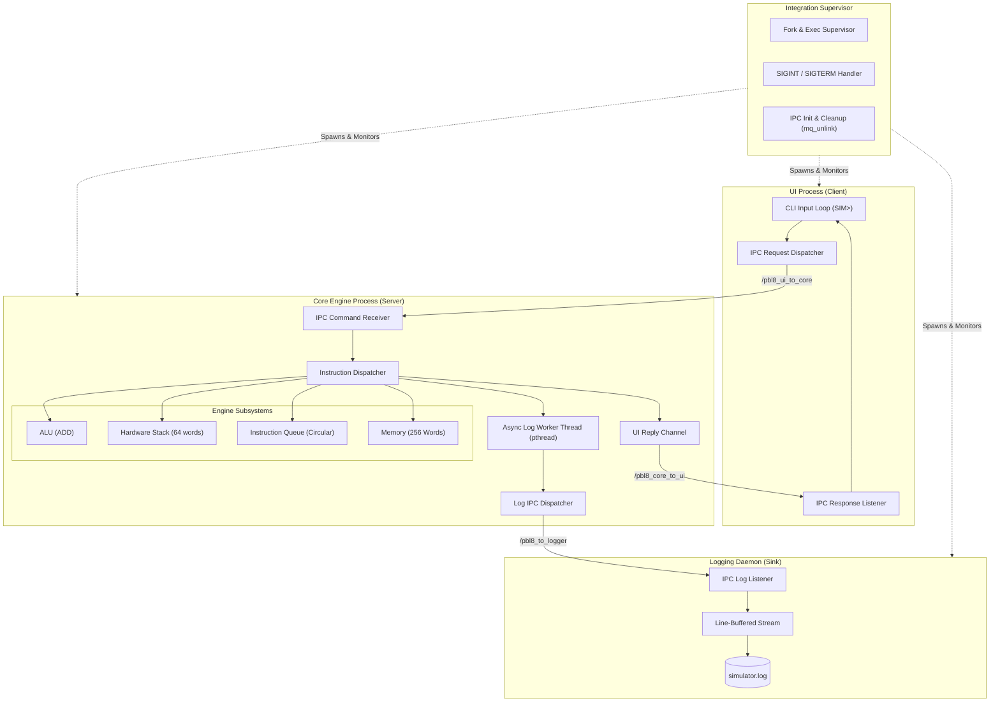

# Project Architecture & Subsystem Ownership Notes

This directory contains technical documentation and subsystem breakdowns for the **PBL Multi-Process POSIX Simulator and Scheduling Suite**. It documents how the system was decomposed, the modules each team member designed and implemented, inter-process communication contracts, and the commit history tracking project development.

---

## 1. System Decomposition & Module Ownership

The repository is modularized into distinct subsystems developed across all phases of the project:

| Engineer | Subsystem Responsibility | Primary Source Files | Research Prototype | Detailed Notes |
| :--- | :--- | :--- | :--- | :--- |
| **Waqqas** | **System Integration, Supervisor & Deadlock Architecture**<br>POSIX IPC contract, process lifecycle supervisor, benchmarking suite, baseline v1, scheduler test framework, Deadlock Core data models & state engine | [`src_v2/launcher/supervisor.c`](https://github.com/sneharao1811/PBL/blob/main/src_v2/launcher/supervisor.c)<br>[`deadlock_v4/include/deadlock.h`](https://github.com/sneharao1811/PBL/blob/main/deadlock_v4/include/deadlock.h)<br>[`deadlock_v4/src/deadlock_core.c`](https://github.com/sneharao1811/PBL/blob/main/deadlock_v4/src/deadlock_core.c)<br>[`benchmarks/run_benchmark.sh`](https://github.com/sneharao1811/PBL/blob/main/benchmarks/run_benchmark.sh)<br>[`scheduler_v3/src/scheduler.c`](https://github.com/sneharao1811/PBL/blob/main/scheduler_v3/src/scheduler.c) *(Gantt/Runner)* | POSIX Shared Memory ([`research/waqqas_shared_memory/`](https://github.com/sneharao1811/PBL/tree/main/research/waqqas_shared_memory)) | [WAQQAS.md](https://github.com/sneharao1811/PBL/blob/main/deliverables_notes/WAQQAS.md) |
| **Sneha** | **UI Frontend, Interactive Shell & Deadlock GUI/RAG**<br>CLI loop, input tokenizer, IPC command serialization, response presentation, FCFS & Round Robin algorithms, Deadlock 12-item CLI, RAG graph visualizer, interactive browser GUI | [`src_v2/ui/ui_main.c`](https://github.com/sneharao1811/PBL/blob/main/src_v2/ui/ui_main.c)<br>[`deadlock_v4/src/deadlock_cli.c`](https://github.com/sneharao1811/PBL/blob/main/deadlock_v4/src/deadlock_cli.c)<br>[`deadlock_v4/src/rag.c`](https://github.com/sneharao1811/PBL/blob/main/deadlock_v4/src/rag.c)<br>[`deadlock_v4/gui/`](https://github.com/sneharao1811/PBL/blob/main/deadlock_v4/gui/)<br>[`scheduler_v3/src/scheduler.c`](https://github.com/sneharao1811/PBL/blob/main/scheduler_v3/src/scheduler.c) *(FCFS & RR)* | Message Queues ([`research/sneha_message_queues/`](https://github.com/sneharao1811/PBL/tree/main/research/sneha_message_queues)) | [SNEHA.md](https://github.com/sneharao1811/PBL/blob/main/deliverables_notes/SNEHA.md) |
| **Siddanth** | **Core CPU Engine & Banker's Avoidance Engine**<br>Memory, hardware stack, ALU, circular instruction queue, in-core asynchronous logging thread, SJF & SRTF algorithms, Banker's Safety Algorithm, Safe Sequence finder, Resource-Request validator | [`src_v2/core/core_main.c`](https://github.com/sneharao1811/PBL/blob/main/src_v2/core/core_main.c)<br>[`deadlock_v4/src/banker.c`](https://github.com/sneharao1811/PBL/blob/main/deadlock_v4/src/banker.c)<br>[`scheduler_v3/src/scheduler.c`](https://github.com/sneharao1811/PBL/blob/main/scheduler_v3/src/scheduler.c) *(SJF & SRTF)* | Anonymous Pipes & FIFOs ([`research/siddanth_pipes_fifos/`](https://github.com/sneharao1811/PBL/tree/main/research/siddanth_pipes_fifos)) | [SIDDANTH.md](https://github.com/sneharao1811/PBL/blob/main/deliverables_notes/SIDDANTH.md) |
| **Rafath** | **Logging Daemon & Deadlock Detection/Recovery**<br>Structured log listener daemon, line-buffered disk stream, timestamp formatting, priority scheduling algorithms, multi-instance Deadlock Detection Algorithm, automated Recovery engine (victim selection & preemption) | [`src_v2/logger/logger_main.c`](https://github.com/sneharao1811/PBL/blob/main/src_v2/logger/logger_main.c)<br>[`deadlock_v4/src/detection.c`](https://github.com/sneharao1811/PBL/blob/main/deadlock_v4/src/detection.c)<br>[`deadlock_v4/src/recovery.c`](https://github.com/sneharao1811/PBL/blob/main/deadlock_v4/src/recovery.c)<br>[`scheduler_v3/src/scheduler.c`](https://github.com/sneharao1811/PBL/blob/main/scheduler_v3/src/scheduler.c) *(Priority)* | Sockets, Signals & Semaphores ([`research/rafath_sockets_signals/`](https://github.com/sneharao1811/PBL/tree/main/research/rafath_sockets_signals)) | [RAFATH.md](https://github.com/sneharao1811/PBL/blob/main/deliverables_notes/RAFATH.md) |

---

## 2. Multi-Process Architecture (Architecture v2)

The core simulator refactors a monolithic CPU loop into three isolated processes communicating via POSIX Message Queues (`<mqueue.h>`):



---

## 3. Git Development History

The project commit log tracks the collaborative evolution of the codebase:

| Commit | Author | Date | Subject | Scope |
| :--- | :--- | :--- | :--- | :--- |
| [`6246213`](https://github.com/sneharao1811/PBL/commit/6246213c2d7a09876577c4ae926d1dd5f970448d) | Waqqas H | 2026-10-14 | `docs: add SOE to readme.md` | Institutional header documentation |
| [`0e617cf`](https://github.com/sneharao1811/PBL/commit/0e617cf7add3af0249b4171dc1f16cea4ecf0222) | sneharao1811 | 2026-10-13 | `docs: comprehensive laboratory report and README update` | Full laboratory report & technical specifications |
| [`25c711d`](https://github.com/sneharao1811/PBL/commit/25c711d180d05a38be2b60a94af274817525d995) | Waqqas H | 2026-10-12 | `perf: add synthetic workload generator and benchmark comparison suite` | Benchmark harness, workload generator, and metrics |
| [`411290c`](https://github.com/sneharao1811/PBL/commit/411290c51b82d5a7d5565d85026151ea60f772c5) | Waqqas H | 2026-10-12 | `feat(scheduler): add ASCII Gantt chart renderer, test suites, and comparison table` | Gantt visualization, test runner, comparative metrics |
| [`9607ee1`](https://github.com/sneharao1811/PBL/commit/9607ee1a2b3dc063be8bd246b6fcdb67f11b36a6) | moidrafath04 | 2026-10-12 | `feat(scheduler): implement priority scheduling policies` | Priority Non-Preemptive & Preemptive algorithms |
| [`8bf0b7b`](https://github.com/sneharao1811/PBL/commit/8bf0b7bf4643bfd37556a1bcfb1480f9686adb79) | mallyasiddanth | 2026-10-11 | `feat(scheduler): implement SJF non-preemptive and SRTF preemptive scheduling` | SJF Non-Preemptive & SRTF Preemptive algorithms |
| [`9cc42f5`](https://github.com/sneharao1811/PBL/commit/9cc42f54194cdbd137ad4d850119b377c111812f) | sneharao1811 | 2026-10-11 | `feat(scheduler): implement FCFS and Round Robin scheduling algorithms` | FCFS and Round Robin time-slicing algorithms |
| [`1d0b5d2`](https://github.com/sneharao1811/PBL/commit/1d0b5d2090a6a8f22163e928c6556fddc75ed423) | Waqqas H | 2026-10-11 | `feat(scheduler): initialize process models, headers, and metrics framework` | Scheduler header models and metrics infrastructure |
| [`c6af8b6`](https://github.com/sneharao1811/PBL/commit/c6af8b6b0ea38f3b19d110d17a4e81b512aa53d1) | Waqqas H | 2026-10-10 | `feat(supervisor): process lifecycle management and build orchestration` | Process supervisor, fork/exec, queue lifecycle, Makefiles |
| [`2ee58ca`](https://github.com/sneharao1811/PBL/commit/2ee58caa1c70968fe8df8f6b5913720254cb477c) | moidrafath04 | 2026-10-09 | `feat(logger): implement dedicated logging daemon` | Logger daemon process, file stream buffer |
| [`8d818df`](https://github.com/sneharao1811/PBL/commit/8d818dfc73fe55dd3f85a079cecca523fa595ed5) | mallyasiddanth | 2026-10-08 | `feat(core): implement CPU engine with ALU, stack, queue, and async worker` | Core engine, stack, memory, queue, async logging worker |
| [`b869442`](https://github.com/sneharao1811/PBL/commit/b86944222decc2c582cb6f77f699fe583ee6e4b5) | sneharao1811 | 2026-10-07 | `feat(ui): implement interactive CLI frontend process` | UI process CLI prompt, input parser, IPC messaging |
| [`793c039`](https://github.com/sneharao1811/PBL/commit/793c0392a1eeff5a6c2346bc6bea67a9b7d65bcb) | Waqqas H | 2026-10-05 | `arch: define shared POSIX IPC protocol and message headers` | Binary protocol frame, opcodes, queues, architecture doc |
| [`296e4f6`](https://github.com/sneharao1811/PBL/commit/296e4f6d08b1d75a8a1cda259c66b677e553264e) | Waqqas H | 2026-10-03 | `feat: single-process baseline simulator v1` | Baseline v1 simulator for empirical speedup comparison |
| [`e5d97d8`](https://github.com/sneharao1811/PBL/commit/e5d97d8c16d03d88c147adfd0bba52d9d830139c) | moidrafath04 | 2026-10-01 | `research: add sockets, signals, and semaphores documentation` | Sockets, signals, semaphores prototype & report |
| [`d630666`](https://github.com/sneharao1811/PBL/commit/d6306661d2b52316d848e8b967f9ba59ae9522b5) | mallyasiddanth | 2026-09-30 | `research: add pipes and fifos implementation` | Anonymous pipes, named FIFOs prototype & report |
| [`85634dd`](https://github.com/sneharao1811/PBL/commit/85634dde4503a19d8ad99dcd70d4f04d609b2b84) | sneharao1811 | 2026-09-30 | `research: add message queues and IPC report` | Message queues sender/receiver prototype & report |
| [`6c43897`](https://github.com/sneharao1811/PBL/commit/6c438971dce6a0b51894dbe4361a8b904840fba3) | Waqqas H | 2026-09-30 | `research: add shared memory fundamentals and demo` | Shared memory prototype & report |
| [`7043906`](https://github.com/sneharao1811/PBL/commit/7043906b41fd28e18130a00d18b81e614becd24e) | sneharao1811 | 2026-09-16 | `Initial commit` | Repository scaffolding |

---

## 4. Build and Verification Quickstart

```bash
# Build all system binaries
make all

# Launch the Multi-Process Simulator (interactive session)
./bin/simulator_v2

# Run automated functional verification
make test

# Execute automated benchmark (Monolithic v1 vs Multi-Process v2)
make benchmark

# Run the Process Scheduling Simulator
./bin/scheduler_v3
```
