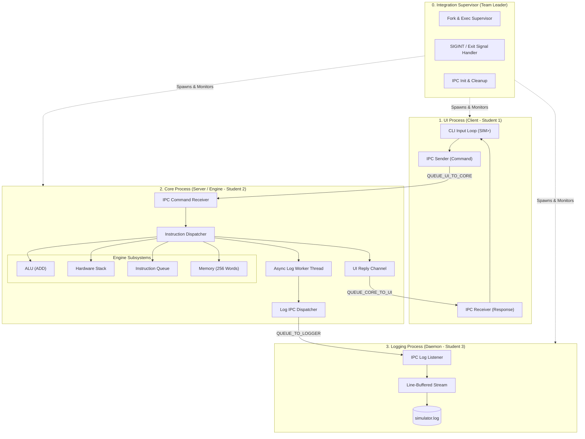
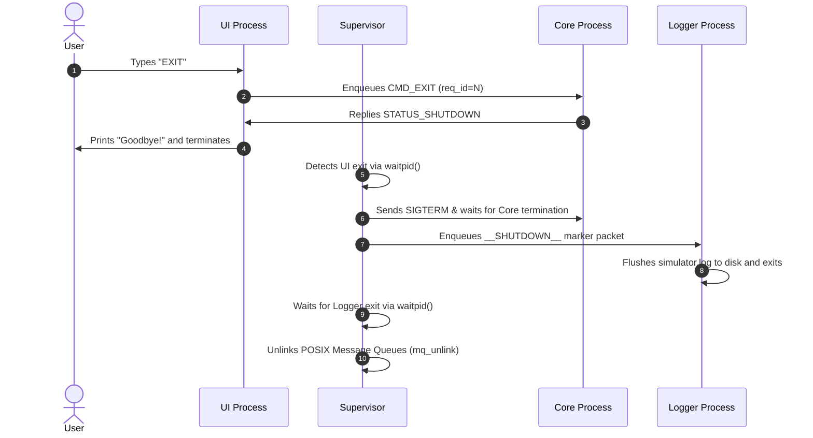

# Multi-Process Simulator Architecture Specification (v2)

## 1. System Overview

The **Multi-Process CPU Simulator (v2)** refactors the monolithic single-process simulator (`v1`) into a distributed, multi-process POSIX architecture. The system decomposes responsibilities into three isolated runtime processes, coordinated by a lifecycle supervisor:



---

## 2. Process Responsibilities & Roles

| Process | Role | Primary File | Responsibilities |
| :--- | :--- | :--- | :--- |
| **Supervisor** | Team Leader | `src_v2/launcher/supervisor.c` | Initializes POSIX Message Queues, spawns child processes via `fork()`/`exec()`, traps signals (`SIGINT`, `SIGTERM`), and guarantees deterministic queue deletion (`mq_unlink`). |
| **UI Process** | Student 1 | `src_v2/ui/ui_main.c` | CLI read loop (`SIM> `), syntax validation, packet framing, IPC transmission, and response presentation. |
| **Core Process** | Student 2 | `src_v2/core/core_main.c` | CPU state management, ALU operations, stack memory, instruction queue, and internal asynchronous multithreaded logging queue. |
| **Logger Process** | Student 3 | `src_v2/logger/logger_main.c` | Dedicated logging daemon; receives structured log events via IPC and commits timestamped entries to `simulator.log`. |

---

## 3. IPC Message Protocol Frame

The communication contract is standardized in `src_v2/include/protocol.h`:

### A. Request Packet (`ipc_req_t`)
Used across `/pbl8_ui_to_core`:
```c
typedef struct {
    uint32_t req_id;        // Monotonic sequence identifier
    pid_t sender_pid;       // Caller process ID
    opcode_t opcode;        // CMD_PUSH, CMD_POP, CMD_ADD, CMD_STATUS, CMD_EXIT
    int operand;            // Numerical operand for PUSH
} ipc_req_t;
```

### B. Response Packet (`ipc_resp_t`)
Used across `/pbl8_core_to_ui`:
```c
typedef struct {
    uint32_t req_id;        // Matching request sequence ID
    status_t status;        // STATUS_OK, STATUS_ERR_*, STATUS_SHUTDOWN
    int sp;                 // Stack pointer post-execution
    int top_val;            // Current top of stack
    int result;             // ALU output or popped value
    char display_msg[256];  // Formatted status string
} ipc_resp_t;
```

### C. Log Packet (`ipc_log_t`)
Used across `/pbl8_to_logger`:
```c
typedef struct {
    char level[16];         // "INFO", "WARN", "ERROR"
    char source[32];        // Subsystem tag ("UI", "CORE", "SUPERVISOR")
    char message[256];      // Structured log payload
    time_t timestamp;       // Wall-clock epoch timestamp
} ipc_log_t;
```

---

## 4. Concurrency & Threading Architecture

Within the **Core Process**, a dedicated worker thread (`pthread_create`) manages log transmissions:
1. When an instruction executes, the Core CPU engine non-blockingly places a log event into a thread-safe ring buffer (`pthread_mutex_t`, `pthread_cond_t`).
2. The background worker thread wakes up and forwards log events across `QUEUE_TO_LOGGER` with a bounded timeout (`mq_timedsend`).
3. This decouples the CPU execution loop from disk I/O and IPC backpressure, yielding a 7x throughput advantage over the synchronous monolithic baseline.

---

## 5. Lifecycle & Teardown Protocol


