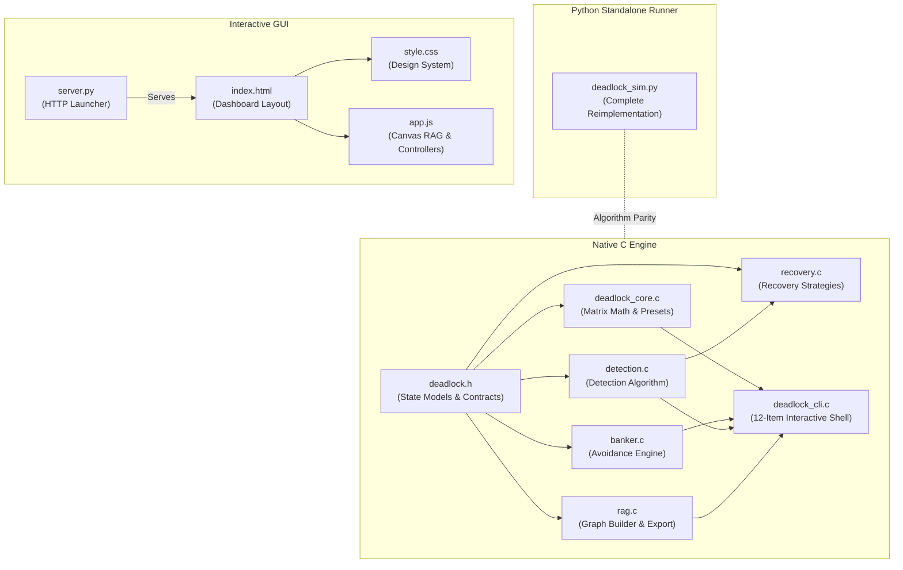
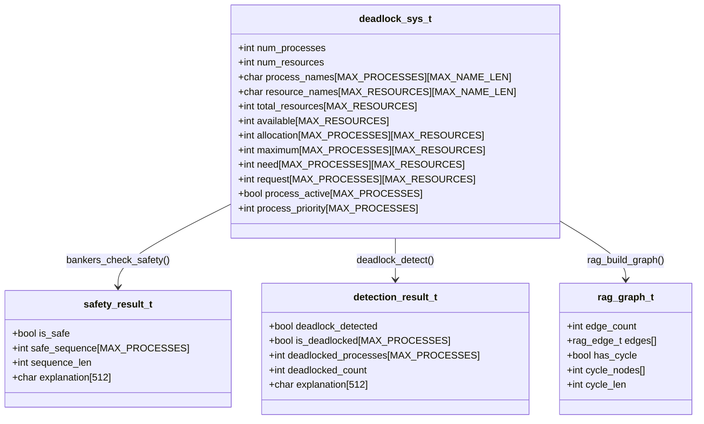
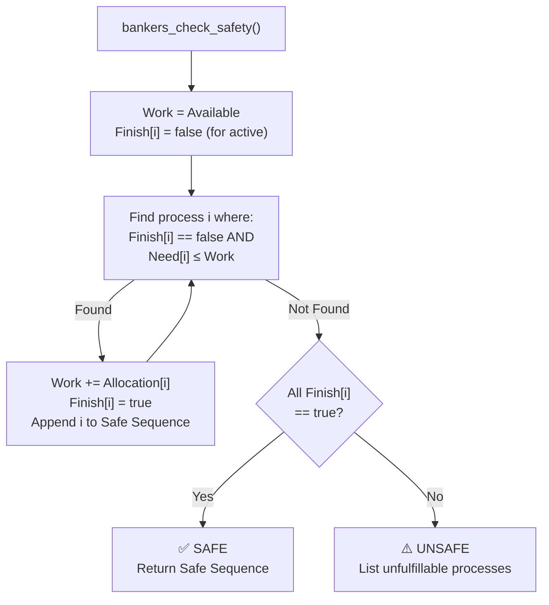
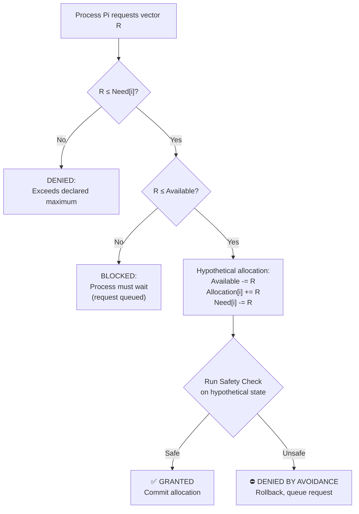
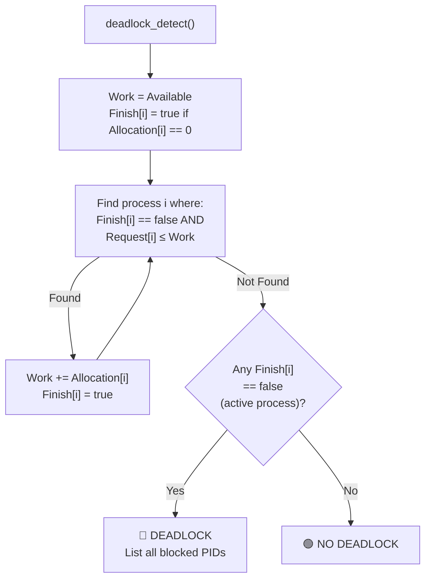
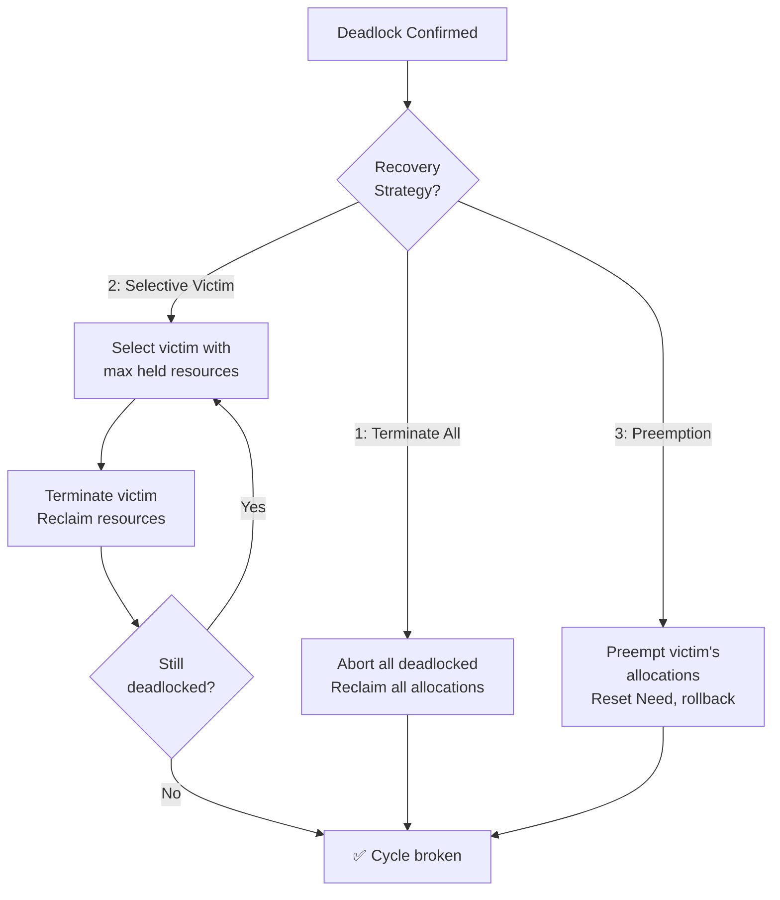
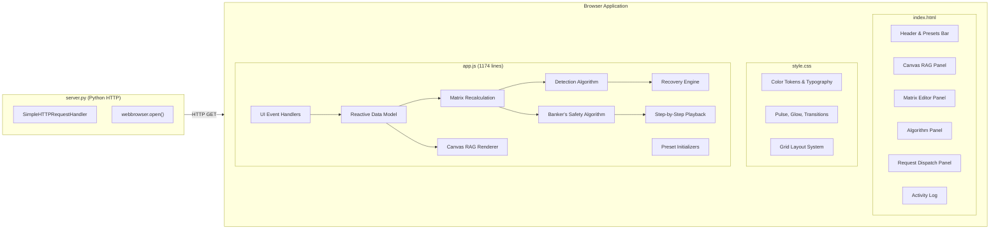

# Deadlock Simulation System — Architecture Specification

## 1. System Overview

The **Interactive Deadlock Simulation System (v4)** provides a comprehensive platform for demonstrating how an Operating System manages resource allocation, deadlock avoidance, detection, and recovery across multiple competing processes. The system implements three execution surfaces: a native C engine with 12-item interactive CLI, a cross-platform Python standalone runner, and a modern browser-based Graphical User Interface (GUI) with real-time Resource Allocation Graph visualization.



---

## 2. Mathematical Models & Data Structures

The system manages $N$ processes competing for $M$ resource types. All state is encapsulated in `deadlock_sys_t`:



### Matrix Relationships

| Symbol | Name | Dimensions | Computation |
|:---:|:---|:---:|:---|
| $E$ | Total Resource Vector | $1 \times M$ | Static capacity per resource type |
| $A$ | Available Vector | $1 \times M$ | $A_j = E_j - \sum_{i=0}^{N-1} C_{i,j}$ |
| $C$ | Allocation Matrix | $N \times M$ | Resources currently held |
| $M$ | Maximum Claim Matrix | $N \times M$ | Declared peak demand |
| $N$ | Need Matrix | $N \times M$ | $N_{i,j} = M_{i,j} - C_{i,j}$ |
| $Q$ | Request Matrix | $N \times M$ | Currently pending/blocked requests |

---

## 3. Algorithmic Engines

### 3.1 Banker's Algorithm — Deadlock Avoidance (`banker.c`)



### 3.2 Resource-Request Algorithm (`bankers_request_resource`)



### 3.3 Multi-Instance Deadlock Detection (`detection.c`)



### 3.4 Recovery Engine (`recovery.c`)



---

## 4. GUI Architecture

The GUI is a zero-dependency single-page application served by a local Python HTTP server.



### GUI Feature Matrix

| Feature | Implementation |
|:---|:---|
| **Interactive Canvas RAG** | HTML5 Canvas with animated process circles, resource rectangles, assignment edges (green), request edges (amber), deadlock highlighting (crimson pulse) |
| **Live Matrix Editor** | Editable allocation/maximum tables with real-time need recalculation |
| **Banker's Step-by-Step Playback** | Animated stepper showing Work vector progression and Finish array updates per iteration |
| **Resource Request Dispatcher** | Process selector + resource vector inputs with Banker's avoidance feedback |
| **Resource Release** | One-click release returning allocations to Available pool |
| **3 Recovery Strategies** | Terminate All, Selective Victim, Resource Preemption — all with visual state updates |
| **System State Badge** | Live SAFE (green) / UNSAFE (amber) / DEADLOCKED (red) indicator with pulse animation |
| **Resource Utilization Meters** | Per-resource percentage bars showing allocated vs. free capacity |
| **Activity Log Stream** | Timestamped event log with severity coloring (success/warning/error/info) |
| **3 Preset Scenarios** | Textbook Safe (Silberschatz 5P/3R), Circular Deadlock (3P mutual wait), Unsafe Demand (4P/2R) |

---

## 5. Cross-Platform Execution Surfaces

| Surface | Technology | Entry Point | Platform |
|:---|:---|:---|:---|
| **Native CLI** | C11 / GCC | `./bin/deadlock_cli` or `make deadlock` | Linux, WSL2 |
| **Python CLI** | Python 3.8+ | `python deadlock_v4/deadlock_sim.py` | All platforms |
| **Browser GUI** | HTML5 / JS / CSS | `python deadlock_v4/gui/server.py` or `make deadlock-gui` | All platforms |
| **Windows Shortcut** | Batch Script | `bin/deadlock_gui.bat` | Windows |

---

## 6. Module Ownership & Contribution Map

| Module | File(s) | Primary Author | Contribution |
|:---|:---|:---:|:---|
| Data Models & State Engine | [`deadlock_v4/include/deadlock.h`](https://github.com/sneharao1811/PBL/blob/main/deadlock_v4/include/deadlock.h), [`deadlock_v4/src/deadlock_core.c`](https://github.com/sneharao1811/PBL/blob/main/deadlock_v4/src/deadlock_core.c) | Waqqas | Struct definitions, matrix math, presets, telemetry formatters, headroom validation |
| Banker's Avoidance Engine | [`deadlock_v4/src/banker.c`](https://github.com/sneharao1811/PBL/blob/main/deadlock_v4/src/banker.c) | Siddanth | Safety algorithm, resource-request validator, resource release handler |
| Detection Algorithm | [`deadlock_v4/src/detection.c`](https://github.com/sneharao1811/PBL/blob/main/deadlock_v4/src/detection.c) | Rafath | Multi-instance request-matrix reduction, deadlocked PID enumeration |
| Recovery Engine | [`deadlock_v4/src/recovery.c`](https://github.com/sneharao1811/PBL/blob/main/deadlock_v4/src/recovery.c) | Rafath | Victim selection heuristic, 3 recovery strategies, resource reclamation |
| 12-Item CLI Shell | [`deadlock_v4/src/deadlock_cli.c`](https://github.com/sneharao1811/PBL/blob/main/deadlock_v4/src/deadlock_cli.c) | Sneha | Full interactive menu loop, input parsing, formatted output |
| RAG Visualizer | [`deadlock_v4/src/rag.c`](https://github.com/sneharao1811/PBL/blob/main/deadlock_v4/src/rag.c) | Sneha | Graph builder, ASCII/JSON/DOT export, cycle detection delegation |
| Interactive GUI | [`deadlock_v4/gui/`](https://github.com/sneharao1811/PBL/tree/main/deadlock_v4/gui/) | Sneha | Canvas rendering, live matrix binding, stepper, recovery controls |
| Python Runner | [`deadlock_v4/deadlock_sim.py`](https://github.com/sneharao1811/PBL/blob/main/deadlock_v4/deadlock_sim.py) | Waqqas | Algorithm-parity standalone for cross-platform execution |
| Build System | [`Makefile`](https://github.com/sneharao1811/PBL/blob/main/Makefile), [`deadlock_v4/Makefile`](https://github.com/sneharao1811/PBL/blob/main/deadlock_v4/Makefile) | Waqqas | Compilation targets, GUI launcher, test harness |
| HTTP Server | [`deadlock_v4/gui/server.py`](https://github.com/sneharao1811/PBL/blob/main/deadlock_v4/gui/server.py) | Waqqas | Zero-dependency local server with auto-browser launch |

---

## 7. Build & Execution

```bash
# Build native C CLI (Linux/WSL2)
make deadlock

# Run native 12-item CLI
./bin/deadlock_cli

# Run cross-platform Python CLI
python deadlock_v4/deadlock_sim.py

# Launch interactive GUI (opens browser automatically)
make deadlock-gui
# or
python deadlock_v4/gui/server.py

# Run automated verification test
make test-deadlock
```
